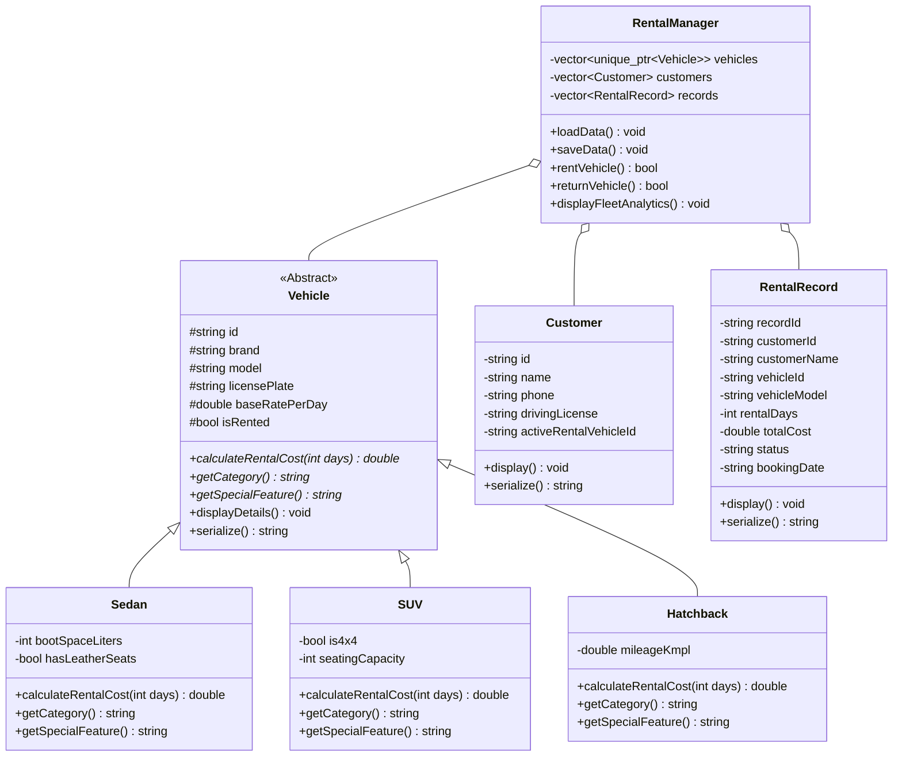

# 🚗 Car Rental Management System (C++ & OOP)

> **A console-based vehicle rental and fleet operations management system built in C++ utilizing core Object-Oriented Programming (OOP) principles and persistent File Handling (`fstream`).**

---

## 🌟 Key Highlights & Resume Alignment

* **Console-Based Vehicle & Booking Management:** Streamlined workflow for vehicle reservations, customer records, and return settlements.
* **Core OOP Architecture:** Leverages **Inheritance, Runtime Polymorphism, Encapsulation, and Abstraction** through an abstract `Vehicle` base class and specialized vehicle categories.
* **Persistent File Storage (`fstream`):** Automatic serialization and deserialization of vehicle fleets, customer profiles, and transaction records on disk.
* **Dynamic Pricing & Invoicing:** Category-specific pricing algorithms (comfort surcharge for Sedans, 4x4 rugged premium for SUVs, city discounts for Hatchbacks) with tax computation and ASCII invoice generation.

---

## 🏛️ Object-Oriented Class Hierarchy



---

## 🛠️ Key Features

1. **Fleet Management:**
   * View all vehicles or filter by available cars only.
   * Search fleet by brand, model, category, or ID.
   * Add new vehicles to fleet dynamically (Admin module).

2. **Customer Profiles:**
   * Register new customers with name, contact number, and driving license.
   * Track customer active rentals to prevent duplicate concurrent bookings.

3. **Booking & Invoicing:**
   * Polymorphic rental cost computation based on duration and vehicle category.
   * Auto-generates structured ASCII booking receipt with itemized breakdown and taxes.

4. **Return & Settlement:**
   * Return rented vehicles with automated late-fee calculation (1.5x daily rate penalty) and damage billing.
   * Generates a return settlement summary and restores vehicle status to `AVAILABLE`.

5. **Fleet Analytics & Reporting:**
   * Real-time metrics on total fleet size, available vs. rented count, fleet utilization rate (%), total bookings, and gross rental revenue.

---

## 📂 Project Structure

```
CarRentalSystem/
├── include/                 # Header declarations
│   ├── Vehicle.h           # Abstract base class
│   ├── Sedan.h             # Derived Sedan class
│   ├── SUV.h               # Derived SUV class
│   ├── Hatchback.h         # Derived Hatchback class
│   ├── Customer.h          # Customer entity
│   ├── RentalRecord.h      # Booking transaction model
│   └── RentalManager.h     # Core manager handling I/O & business logic
├── src/                    # Source implementations
│   ├── Vehicle.cpp
│   ├── Customer.cpp
│   ├── RentalRecord.cpp
│   ├── RentalManager.cpp
│   └── main.cpp            # Interactive CLI driver
├── data/                   # Persistent storage files (fstream)
│   ├── vehicles.txt
│   ├── customers.txt
│   └── rentals.txt
├── run.bat                 # 1-click Windows compilation & launch script
├── .gitignore              # Ignores binary outputs (*.exe, *.o)
└── README.md               # Documentation
```

---

## 🚀 How to Compile & Run

### Prerequisites
* Any C++17 compliant compiler (`g++` / MinGW / Clang / MSVC)

### Windows (1-Click Run)
Double click `run.bat` or run in terminal:
```powershell
.\run.bat
```

### Manual Compilation (Windows / Linux / macOS)
```bash
g++ -std=c++17 -O3 src/*.cpp -Iinclude -o CarRentalSystem
./CarRentalSystem
```

---

## 👤 Author

* **Palak Kapila**
* GitHub: [@PalakKapila72](https://github.com/PalakKapila72)
* Email: [palakkapila72@gmail.com](mailto:palakkapila72@gmail.com)
